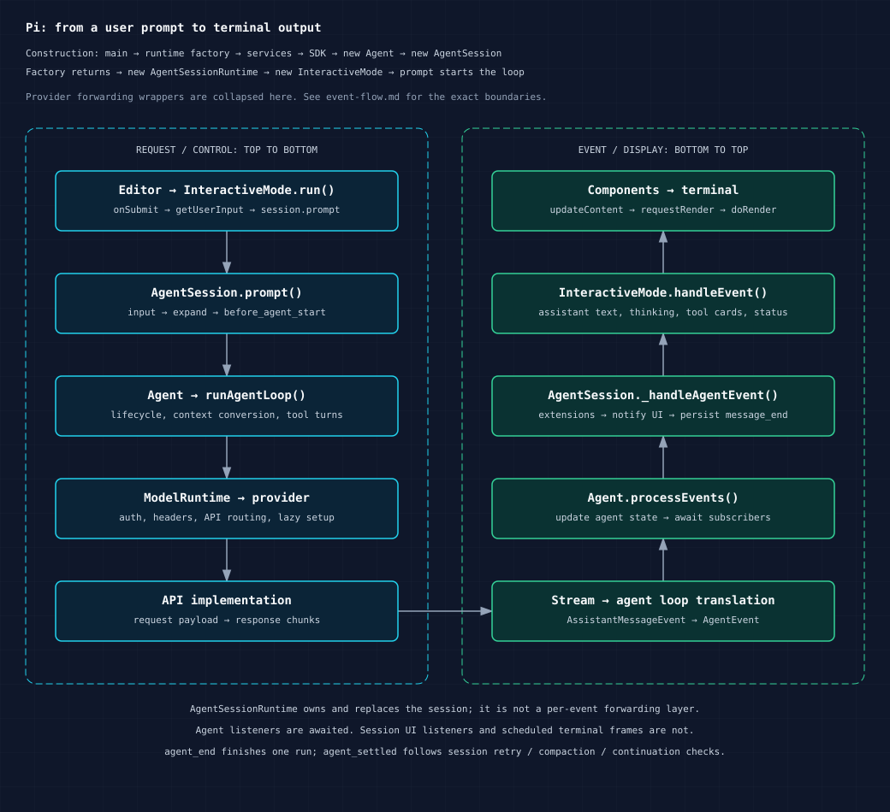
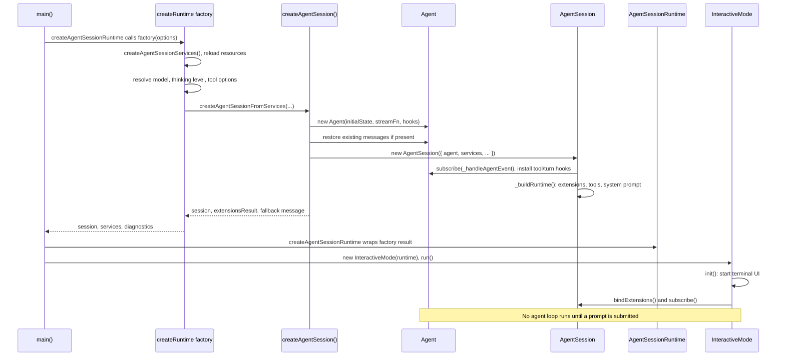
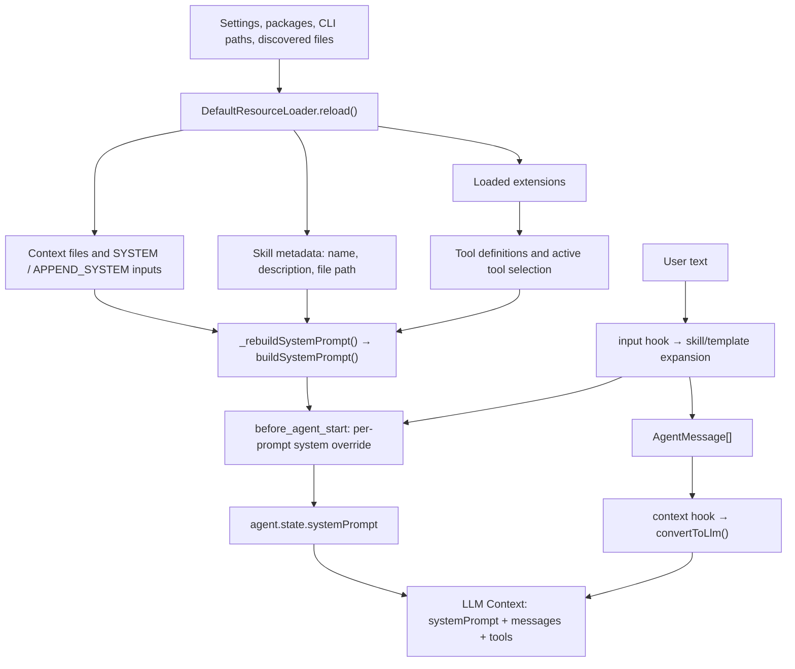

# Interactive agent construction, prompts, and event flow

This document traces the standard CLI interactive mode at commit `6f140a902`. It follows a prompt from the terminal to a provider and back to the screen, including tool execution, extensions, persistence, and completion. Source links are relative to this document; line numbers describe this revision. Snippets are shortened excerpts with explanatory comments, not standalone programs.

The four main paths are:

1. **Construction:** `main()` → `createAgentSessionRuntime(factory, ...)` → factory creates services → `createAgentSessionFromServices()` → SDK `createAgentSession()` → `new Agent()` → `new AgentSession({ agent, ... })` → `new AgentSessionRuntime(...)` → `new InteractiveMode(runtime)`.
2. **Prompt preparation:** resource discovery → tool registry and base system prompt → user input interception → skill/template expansion → `before_agent_start` → per-request context conversion.
3. **Submission:** terminal input → editor `onSubmit` → `getUserInput()` → `session.prompt()` → `agent.prompt()` → `runAgentLoop()`.
4. **Response:** API implementation → `AssistantMessageEventStream` and forwarding wrappers → agent loop translates events → `Agent.processEvents()` → `AgentSession._handleAgentEvent()` → `InteractiveMode.handleEvent()` → components → scheduled terminal rendering.

Construction is runtime initialization, not the package build pipeline. Creating an `Agent` does not start an LLM request. The SDK creates the agent **before** the session; the runtime wrapper is constructed **after** its factory returns the session.



[PNG version](diagram/event-flow@2x.png). The overview collapses provider forwarding wrappers; the detailed paths below show their role.

## 1. Ownership and construction

| Component | Responsibility | Source |
| --- | --- | --- |
| `main()` | Parse CLI options, select session/cwd, resolve trust, define the runtime factory, choose interactive/print/RPC mode | [main.ts](../packages/coding-agent/src/main.ts#L703) |
| `AgentSessionServices` | Cwd-bound settings, resource loader, model/auth runtime, setup diagnostics | [agent-session-services.ts](../packages/coding-agent/src/core/agent-session-services.ts#L151) |
| `AgentSessionRuntime` | Own the current session and services; replace them for new/resumed/forked/imported sessions and rebind the UI | [agent-session-runtime.ts](../packages/coding-agent/src/core/agent-session-runtime.ts#L78) |
| `AgentSession` | Prompt policy, extensions, tools, persistence, compaction, retries, session-level events | [agent-session.ts](../packages/coding-agent/src/core/agent-session.ts#L327) |
| `Agent` | Transcript and live state, run lifecycle, abort controller, steering/follow-up queues, awaited event listeners | [agent.ts](../packages/agent/src/agent.ts#L171) |
| Agent loop | Request assistant messages, translate stream events, execute tools, decide whether another turn is needed | [agent-loop.ts](../packages/agent/src/agent-loop.ts#L96) |
| `ModelRuntime` | Resolve request auth/headers and route calls to the configured provider | [model-runtime.ts](../packages/coding-agent/src/core/model-runtime.ts#L636) |
| `InteractiveMode` | Input routing and presentation of session events | [interactive-mode.ts](../packages/coding-agent/src/modes/interactive/interactive-mode.ts#L400) |



The services factory loads resources and applies extension provider registrations before CLI model selection. `createAgentSessionFromServices()` delegates to the SDK using those already-created services. The SDK installs a `streamFn` that calls `modelRuntime.streamSimple()`, a `convertToLlm` adapter, and extension hooks for context, payload, headers, and response metadata.

The initial agent has an empty system prompt and tool array. `AgentSession._buildRuntime()` creates the extension runner and tool definitions, wraps the tools, selects active tools, and rebuilds the system prompt. This is why the session constructor is part of prompt setup even though it receives an existing agent.

```ts
// sdk.ts — construction order, with unrelated options omitted.
agent = new Agent({
    initialState: { systemPrompt: "", model, thinkingLevel, tools: [] },
    convertToLlm: convertToLlmWithBlockImages,
    streamFn: async (model, context, options) => {
        // Actual code also supplies timeouts, retries, and header transforms.
        return modelRuntime.streamSimple(model, context, options);
    },
});

const session = new AgentSession({
    agent, // Existing agent; AgentSession does not construct it.
    sessionManager, settingsManager, cwd, resourceLoader, modelRuntime,
    // Tool selection and extension options omitted.
});
```

Sources: [SDK construction](../packages/coding-agent/src/core/sdk.ts#L306), [session constructor](../packages/coding-agent/src/core/agent-session.ts#L395), [runtime wrapper factory](../packages/coding-agent/src/core/agent-session-runtime.ts#L422).

`InteractiveMode` installs a runtime rebind callback. Replacing a session aborts and tears down the old session, uses the stored factory to create the replacement, then rebinds the presentation. The runtime is an ownership/lifecycle layer; it is not another emitter in every response event's path.

## 2. System prompt and skills orchestration

### Resource loading and base prompt

`DefaultResourceLoader.reload()` resolves package/settings/CLI resource paths, loads extensions, skills, prompt templates and themes, then loads context files and system prompt inputs. Resources are loaded before prompt submission; their discovery does not itself invoke the LLM.

`AgentSession._rebuildSystemPrompt()` gathers those resources together with the **active** tools' prompt snippets and guidelines, and calls `buildSystemPrompt()`.



The assembled base prompt contains, in order:

1. The built-in coding-assistant instructions, active tool snippets, and guidelines, or a custom system prompt replacing that built-in portion.
2. Appended system prompt text.
3. Loaded context file bodies in `<project_context>` / `<project_instructions path="...">` blocks.
4. Available skill metadata, when `read` or `bash` is active.
5. The working directory.

Tool schemas and implementations are separate from the prompt's textual tool list: the request also carries `Context.tools`. A tool without a prompt snippet can still be available through its schema.

Context discovery selects the first matching instruction file per directory, in this order: `AGENTS.override.md`, `AGENTS.md`, `AGENTS.MD`, `CLAUDE.md`, `CLAUDE.MD`. It loads global agent-directory context first, then ancestor context from outermost directory down to cwd, with special handling for nested worktree duplication. `--no-context-files` suppresses this load. This path does not recursively discover every subdirectory's instructions as the model reads files.

For default system-file discovery, a trusted project's `.pi/SYSTEM.md` takes precedence over the global agent-directory `SYSTEM.md`; `APPEND_SYSTEM.md` follows the same project/global selection. Explicit prompt inputs and SDK loader overrides can alter this. Project resource trust filtering and context-file loading are separate code paths; do not assume all instruction files are filtered like project extensions.

Sources: [resource discovery](../packages/coding-agent/src/core/resource-loader.ts#L388), [context discovery](../packages/coding-agent/src/core/resource-loader.ts#L119), [prompt inputs](../packages/coding-agent/src/core/resource-loader.ts#L526), [base prompt assembly](../packages/coding-agent/src/core/agent-session.ts#L1065), [buildSystemPrompt](../packages/coding-agent/src/core/system-prompt.ts#L29).

### Two ways to load a skill

**Model-selected skill:** startup discovery reads files to extract metadata, but only the catalog is inserted into the system prompt. `formatSkillsForPrompt()` includes names, descriptions, and locations, and instructs the model to load a matching skill with `read`, or `bash` if `read` is unavailable. The model's resulting tool call follows the ordinary tool loop. Its result makes the skill body available to subsequent assistant requests. There is no automatic semantic matcher in `AgentSession` that reads a skill body for every matching natural-language prompt.

Skills with `disable-model-invocation: true` are omitted from that catalog. If neither `read` nor `bash` is active, the builder omits the skill catalog entirely.

**Explicit skill command:** `/skill:name arguments` is expanded by `AgentSession._expandSkillCommand()` before the user message is created. It reads the file, strips frontmatter, adds the skill directory, and puts the body into the **user message**:

```xml
<skill name="example" location="/absolute/path/example/SKILL.md">
References are relative to /absolute/path/example.

The skill's instructions, without YAML frontmatter.
</skill>

arguments
```

The current implementation appends arguments after a blank line, without a literal `User:` prefix. The interactive UI recognizes this wrapper with `parseSkillBlock()` and renders it as a collapsible skill invocation. That display is separate from the expanded text sent to the model.

Sources: [skill catalog formatter](../packages/coding-agent/src/core/skills.ts#L355), [explicit expansion](../packages/coding-agent/src/core/agent-session.ts#L1353), [skill display](../packages/coding-agent/src/modes/interactive/interactive-mode.ts#L3629). See also [Skills](../packages/coding-agent/docs/skills.md) for discovery locations and configuration.

### Extension timing

| Hook | When it runs | Effect |
| --- | --- | --- |
| `session_start`, then `resources_discover` | When session extensions bind; also on relevant reload paths | Extensions can add skill/prompt/theme paths; the base prompt is rebuilt |
| Registered extension command | At the beginning of `session.prompt()` for slash input | Can handle the request immediately, including during streaming |
| `input` | Before skill and prompt-template expansion | Can handle input or replace text/images |
| `before_agent_start` | After expansion and idle prompt preflight, before `agent.prompt()` | Can inject custom messages and replace the effective system prompt |
| `context` | Before each assistant request, via SDK `transformContext` | Sequentially transforms a cloned message list before `convertToLlm()` |
| `before_provider_headers` | During request preparation | Transforms outgoing headers |
| `before_provider_request` | After the API implementation constructs its payload | Transforms the provider-specific payload |
| `after_provider_response` | After response headers arrive | Observes HTTP status/headers; this is not a text-delta hook |
| `tool_call` / `tool_result` | Before tool execution / after execution | Can block calls or modify results |

`before_agent_start` handlers are chained: each sees the system prompt returned by earlier handlers. A fresh ordinary prompt starts from `_baseSystemPrompt`, so overrides do not accumulate across independent prompts. Queued steering/follow-up input returns before this hook and does not rerun the whole prompt preflight when delivered.

Between completed turns within a run, the session's `prepareNextTurnWithContext` hook can compact context and refresh the effective prompt, active tools, model, and thinking level. The first assistant request uses the initial snapshot; this refresh runs before subsequent turns.

Sources: [extension binding](../packages/coding-agent/src/core/agent-session.ts#L2445), [prompt preparation](../packages/coding-agent/src/core/agent-session.ts#L1159), [next-turn refresh](../packages/coding-agent/src/core/agent-session.ts#L561), [context handlers](../packages/coding-agent/src/core/extensions/runner.ts#L1034), [before-agent handlers](../packages/coding-agent/src/core/extensions/runner.ts#L1131).

## 3. User input: terminal to agent loop

For ordinary text submitted while idle:

```mermaid
sequenceDiagram
    participant Terminal as ProcessTerminal / TuiBase
    participant Editor as CustomEditor / Editor
    participant UI as InteractiveMode
    participant Session as AgentSession
    participant Agent
    participant Loop as runAgentLoop
    Terminal->>Editor: handleInput(data) on focused component
    Editor->>Editor: submitValue(): expand paste markers, clear editor
    Editor->>UI: onSubmit(text)
    UI->>UI: resolve getUserInput(), or buffer pendingUserInputs
    UI->>Session: run() awaits session.prompt(text)
    Session->>Session: command/input hooks, expand skill/template
    Session->>Session: validate model/auth, compaction preflight
    Session->>Session: build user/custom messages, before_agent_start
    Session->>Agent: _runAgentPrompt() → agent.prompt(messages)
    Agent->>Agent: runWithLifecycle(): active run + abort controller
    Agent->>Loop: runAgentLoop(messages, snapshot, config, sink, signal, streamFn)
    Note over UI,Loop: The editor can continue receiving input during this run
```

`CustomEditor.handleInput()` checks extension shortcuts and configurable app actions before delegating to the base editor. The base editor uses `tui.input.submit`, then `submitValue()` calls `onSubmit`. The TUI does not send every keystroke to the agent.

```ts
// InteractiveMode.run() — ordinary idle submission.
while (true) {
    const userInput = await this.getUserInput();
    try {
        await this.session.prompt(userInput);
    } catch (error: unknown) {
        // Actual code displays the error in the chat.
    }
}
```

The submit handler has several branches before this ordinary path:

| Input/state | Path |
| --- | --- |
| Built-in slash command such as `/settings` | Handled by `InteractiveMode`; no ordinary user prompt |
| `!command` / `!!command` | Bash execution path; `!!` excludes the result from LLM context |
| Ordinary text while streaming | `session.prompt(text, { streamingBehavior: "steer" })` |
| Follow-up action while streaming | `session.prompt(text, { streamingBehavior: "followUp" })` |
| Ordinary text while compacting | Buffered in the UI's compaction queue, then submitted/queued after compaction |
| Extension command while compacting/streaming | Routed to `session.prompt()` for immediate command dispatch |

Steering is delivered after the current assistant turn and its tool calls, before the next assistant request. It does **not** cancel the current HTTP stream. Follow-up messages are consumed when the loop would otherwise stop. Abort is a separate action using an `AbortSignal`.

Sources: [CustomEditor](../packages/coding-agent/src/modes/interactive/components/custom-editor.ts#L103), [editor submission](../packages/tui/src/components/editor.ts#L1352), [submit routing](../packages/coding-agent/src/modes/interactive/interactive-mode.ts#L2964), [input promise](../packages/coding-agent/src/modes/interactive/interactive-mode.ts#L3908), [Agent.prompt](../packages/agent/src/agent.ts#L352).

## 4. Request path and provider event generation

Inside `streamAssistantResponse()`, the loop creates each request in this order:

```text
AgentContext.messages: AgentMessage[]
  → transformContext(messages)             [SDK: extension context hook]
  → convertToLlm(messages)                 [app messages → provider-compatible messages]
  → Context { systemPrompt, messages, tools }
  → configured Agent.streamFunction
  → SDK streamFn                           [timeouts/retry/header policy]
  → ModelRuntime.streamSimple()
  → lazyStream + prepareRequest()          [resolve auth and transform headers]
  → configured provider.streamSimple()
  → selected API streamSimple() → stream()
  → provider request and response chunks
```

Provider composition can choose an extension implementation, a built-in provider implementation, or a compatibility API selected by `model.api`. The API module itself can be lazy-loaded. These `lazyStream()` wrappers create outer `AssistantMessageEventStream` instances and forward inner events; there need not be one shared stream object end to end. Setup failures also become stream `error` events.

**Concrete example: `model.api === "openai-completions"`.** The API's `streamSimple()` maps generic options such as reasoning into completion-specific options, then calls `stream()`. `stream()` starts asynchronous work and immediately returns a stream. It builds the OpenAI payload, applies `onPayload`, opens `client.chat.completions.create(...).withResponse()`, calls `onResponse`, and pushes normalized events while reading chunks.

```ts
// openai-completions.ts — within the OpenAI chunk loop.
const block = ensureTextBlock(); // Creates the block and emits text_start if needed.
block.text += choice.delta.content;
stream.push({
    type: "text_delta",
    contentIndex: getContentIndex(block),
    delta: choice.delta.content, // Newly received text.
    partial: output,            // Accumulated AssistantMessage, not just this delta.
});
```

The same implementation accumulates thinking and tool-call arguments, finalizes content blocks, records usage/stop reason, and pushes either `done` with the final message or `error` with an assistant error message.

`AssistantMessageEventStream` supplies two interfaces:

- `for await (const event of stream)`: receive start, block updates, and terminal events in queue order.
- `await stream.result()`: obtain the final `AssistantMessage`. Both `done` and `error` resolve this result; an `error` event is not inherently a rejected result promise.

`push()` synchronously queues/delivers events. It does not wait for the eventual TUI to render. Partial messages contain mutable accumulated content; the loop's `{ ...partialMessage }` copies only the top level. Consumers retaining historical snapshots need their own copies.

The built-in [`openaiProvider()`](../packages/ai/src/providers/openai.ts) currently selects **`openai-responses`**. The completions implementation is an example for models/providers configured for that API, not a universal OpenAI route.

Sources: [request conversion](../packages/agent/src/agent-loop.ts#L296), [SDK stream policy](../packages/coding-agent/src/core/sdk.ts#L314), [ModelRuntime](../packages/coding-agent/src/core/model-runtime.ts#L636), [provider routing](../packages/coding-agent/src/core/provider-composer.ts#L463), [lazy forwarding](../packages/ai/src/api/lazy.ts), [completion stream](../packages/ai/src/api/openai-completions.ts#L311), [event stream implementation](../packages/ai/src/utils/event-stream.ts).

## 5. Response events: translation, state, extensions, persistence, UI

There are three related event vocabularies, not three interchangeable names for the same stream:

| Layer | Type | Examples |
| --- | --- | --- |
| Provider/API | `AssistantMessageEvent` | `start`, `text_delta`, `thinking_delta`, `toolcall_delta`, `done`, `error` |
| Agent loop | `AgentEvent` | `agent_start`, `turn_start`, `message_start/update/end`, `tool_execution_start/update/end`, `turn_end`, `agent_end` |
| Session | `AgentSessionEvent` | Agent events, `agent_end` with `willRetry`, plus `agent_settled`, queue, compaction, retry, and session metadata events |

The loop translates provider events as follows:

| Provider event | Emitted agent event | Meaning |
| --- | --- | --- |
| `start` | `message_start` for assistant | Assistant message has begun |
| `text_*`, `thinking_*`, `toolcall_*` | `message_update` | Carries both accumulated `message` and original `assistantMessageEvent` |
| `done` / `error` | `message_end` | Uses `await response.result()` to finalize the message |
| No `start` before terminal event | Synthetic `message_start`, then `message_end` | Handles failures before streaming starts |

`agent_start`, `turn_start`, user-message events, tool execution events, `turn_end`, and `agent_end` are generated by agent-core, not by the OpenAI response parser.

```ts
// agent-loop.ts — shared branch for text/thinking/tool-call block events.
partialMessage = event.partial;
context.messages[context.messages.length - 1] = partialMessage;
await emit({
    type: "message_update",
    assistantMessageEvent: event, // Retains provider-level detail.
    message: { ...partialMessage },
});
```

The `emit` above is a callback supplied by `Agent`, not a global event bus:

Agent-core also exports `agentLoop()` / `agentLoopContinue()` adapters that expose an `EventStream<AgentEvent, AgentMessage[]>`. The standard `Agent` path uses the awaited `runAgentLoop()` / `runAgentLoopContinue()` sink APIs directly, so those agent-event stream adapters are not an extra stage here.

```ts
// Agent.runPromptMessages() — shortened call from inside runWithLifecycle().
await runAgentLoop(
    messages,
    this.createContextSnapshot(),
    this.createLoopConfig(options),
    (event) => this.processEvents(event), // The loop's event sink.
    signal,
    this.streamFunction,
);
```

`Agent.processEvents()` updates state **before** dispatching listeners. For example, `message_update` replaces `state.streamingMessage`; `message_end` clears it and appends the finalized message to `state.messages`; tool start/end updates `pendingToolCalls`. It then awaits subscribers in subscription order.

For an ordinary finalized assistant message, the chain is:

```mermaid
sequenceDiagram
    participant API as API + stream wrappers
    participant Loop as streamAssistantResponse
    participant Agent as Agent.processEvents
    participant Session as AgentSession
    participant Ext as ExtensionRunner
    participant UI as InteractiveMode
    participant Store as SessionManager
    participant TUI as Components / TuiBase
    API-->>Loop: done or error event, result() returns final message
    Loop->>Agent: await emit(message_end)
    Agent->>Agent: append message to state.messages
    Agent->>Session: await _handleAgentEvent(message_end)
    Session->>Ext: await _emitExtensionEvent(message_end)
    Ext-->>Session: optional replacement message
    Session->>Session: apply replacement in place
    Session->>UI: _emit(message_end), invokes listener without awaiting it
    UI->>TUI: updateContent(message, false), requestRender()
    Session->>Store: appendMessage(event.message)
    Session-->>Agent: internal handler finishes
    Agent-->>Loop: event sink finishes
    Note over UI,TUI: Rendering is scheduled separately, no frame per event guarantee
```

The ordering has practical consequences:

- Agent state already contains a finalized message when a `message_end` listener runs.
- Session extension handlers run before session/UI subscribers. A `message_end` replacement is applied in place so agent state, the event, and later persistence agree.
- In the ordinary agent-event path, the session calls UI subscribers **before** `SessionManager.appendMessage()`. A listener must not assume the current message is already in the session tree.
- Session persistence happens on `message_end`, not every text delta. Custom messages use custom-message entries. Bash and compaction records have their own persistence paths.
- Agent subscriber promises are awaited; session subscriber promises are not. The UI subscribes with an async callback, but `AgentSession._emit()` simply calls it. The synchronous portion of an initialized `handleEvent()` runs immediately; work after an `await` does not delay the agent through this subscription.

```ts
// Agent.processEvents(): awaited listeners.
for (const listener of this.listeners) {
    await listener(event, signal);
}

// AgentSession._emit(): synchronous notification, no promise collection.
for (const l of this._eventListeners) {
    l(event);
}
```

Sources: [agent state reduction](../packages/agent/src/agent.ts#L543), [session forwarding and persistence](../packages/coding-agent/src/core/agent-session.ts#L642), [extension event adaptation](../packages/coding-agent/src/core/agent-session.ts#L775), [UI subscription and handling](../packages/coding-agent/src/modes/interactive/interactive-mode.ts#L3159). Type definitions: [AgentEvent](../packages/agent/src/types.ts#L431), [AssistantMessageEvent](../packages/ai/src/types.ts#L546), [AgentSessionEvent](../packages/coding-agent/src/core/agent-session.ts#L150).

## 6. Tools, turns, and completion

A **turn** contains one assistant response plus its tool executions/results. A **run** can contain several turns. A session prompt cycle can contain several runs because of retries or recovery.

For a prompt that calls `read` once and then answers, the normal event trace is:

```text
agent_start
turn_start
  message_start(user)
  message_end(user)
  message_start(assistant)
  message_update × N              # toolcall_* means arguments are being generated
  message_end(assistant)          # complete tool call is now available
  tool_execution_start(read)
  tool_execution_update × N       # optional progress from the tool implementation
  tool_execution_end(read)
  message_start(toolResult)
  message_end(toolResult)
turn_end                          # assistant + toolResults
  prepareNextTurn                 # optional refresh/compaction, not an AgentEvent
turn_start
  message_start(assistant)
  message_update × N              # text/thinking/etc.
  message_end(assistant)
turn_end
agent_end                         # last event of this agent-core run
  session post-run checks         # retry / compaction / newly queued continuation
agent_settled                     # session prompt cycle finishes
```

`toolcall_delta` is generation of a tool call; `tool_execution_update` is actual tool progress. Rendering a tool card during argument streaming does not mean the tool has started executing.

The loop resolves the tool, prepares and validates arguments, runs the `beforeToolCall` hook, executes the wrapped tool, runs `afterToolCall`, emits execution completion, and constructs a `ToolResultMessage`. That message becomes input to the next assistant request. Missing tools, invalid arguments, blocked calls, and execution failures produce error tool results. Tool calls from an assistant response truncated with `stopReason: "length"` are failed rather than executed with potentially incomplete arguments.

`Agent` defaults to parallel tool execution. The loop uses sequential execution if configured globally or if any tool in that batch declares `executionMode: "sequential"`. In parallel mode, execution updates/end events can interleave, while tool-result messages are emitted in original call order after the batch settles.

Normal continuation checks tool results and steering first, then follow-ups before stopping. Hooks such as `shouldStopAfterTurn` and batch termination can affect continuation; error/aborted assistant messages end the run early.

**Completion boundaries:** `agent_end` is emitted before `Agent.finishRun()` clears `isStreaming` and resolves the active run's idle promise. `AgentSession._runAgentPrompt()` then evaluates retry/compaction/continuation, potentially calling `agent.continue()` and producing another `agent_start` … `agent_end` sequence. Its `finally` block flushes pending messages and emits `agent_settled`. Use session `waitForIdle()` / the prompt promise when waiting for session-level completion; a rendered final text block or one `agent_end` is insufficient.

The session's `agent_end.willRetry` is a retry-policy hint. It is not a general flag for every possible post-run compaction or queued continuation.

Sources: [turn loop](../packages/agent/src/agent-loop.ts#L155), [tool execution](../packages/agent/src/agent-loop.ts#L420), [Agent run settlement](../packages/agent/src/agent.ts#L486), [session prompt-cycle settlement](../packages/coding-agent/src/core/agent-session.ts#L1105).

## 7. Event handling to terminal output

`InteractiveMode.handleEvent()` translates session events into component changes:

| Event | Presentation action |
| --- | --- |
| Assistant `message_start` | Create an `AssistantMessageComponent` and add it to chat |
| `message_update` | Render accumulated assistant content with `updateContent(message, true)`; create/update tool argument cards |
| Assistant `message_end` | Finalize with `updateContent(message, false)`; finish argument display and show errors/diagnostics |
| `tool_execution_start/update/end` | Mark execution started; update progress/result in the matching tool card |
| `turn_start` | Show working indicator and terminal progress |
| `agent_end` | Clear working/streaming presentation state |
| `agent_settled` | Check deferred shutdown |
| Retry/compaction events | Update status indicators, restore handlers, and rebuild transcript when needed |

`AssistantMessageComponent.updateContent()` rebuilds its text/thinking children using `Markdown` and `Text`. Tool output is handled by separate `ToolExecutionComponent` instances keyed by `toolCallId`.

The final path is:

```text
handleEvent()
  → update component tree
  → ui.requestRender()
  → stable TUI proxy → current TuiMainScreen or TuiAltScreen
  → TuiBase schedules/coalesces rendering (16 ms minimum interval)
  → renderer.doRender() → component render(width) → terminal output
```

Several stream events can therefore update the components before one terminal frame is written. `requestRender()` requests a future render; it is not an immediate write of the delta. `renderNow()` is the separate immediate-render API.

Sources: [UI event switch](../packages/coding-agent/src/modes/interactive/interactive-mode.ts#L3170), [assistant component](../packages/coding-agent/src/modes/interactive/components/assistant-message.ts#L100), [renderer construction/proxy](../packages/coding-agent/src/modes/interactive/tui-renderer.ts), [render scheduling](../packages/tui/src/tui.ts#L944).

## 8. The experimental mini TUI is a separate path

The open file [`experimental/mini/tui/session.ts`](../packages/coding-agent/src/experimental/mini/tui/session.ts) does not sit between `AgentSession` and standard `InteractiveMode`.

It connects a presentation to remote `Sessions`, `Lane`, and `Models` services through an RPC peer. `lane.watch()` obtains a snapshot and subscription ID; `lane.start()` starts delivery of buffered events. Incoming `HarnessEvent` values are applied with `reduceLaneSnapshot()`, then local listeners are notified that the replicated state changed. A reducer result of `"rebase"` triggers resubscription.

```text
Mini RPC Lane events
  → check subscriptionId
  → reduceLaneSnapshot(snapshot.lane, event)
  → publish() to local subscribers
  → presentation reads updated snapshot
```

This uses remote events and replicated state. The standard interactive path documented above directly subscribes to the in-process `AgentSession`.

## 9. Suggested breakpoints for one end-to-end trace

1. [SDK `new Agent`](../packages/coding-agent/src/core/sdk.ts#L306): inspect injected stream/context functions.
2. [Session `_rebuildSystemPrompt`](../packages/coding-agent/src/core/agent-session.ts#L1065): inspect loaded skills, context, active tool contributions.
3. [TUI submit handler](../packages/coding-agent/src/modes/interactive/interactive-mode.ts#L2964): distinguish idle submission, streaming queues, and commands.
4. [Session `prompt`](../packages/coding-agent/src/core/agent-session.ts#L1159): compare raw input, expanded text, messages, and effective system prompt.
5. [Loop `streamAssistantResponse`](../packages/agent/src/agent-loop.ts#L296): inspect converted messages and the provider request boundary.
6. [Completion text-delta generation](../packages/ai/src/api/openai-completions.ts#L589): only when the selected model uses `openai-completions`.
7. [Agent `processEvents`](../packages/agent/src/agent.ts#L543): watch lifecycle state change before listeners.
8. [Session `_handleAgentEvent`](../packages/coding-agent/src/core/agent-session.ts#L642): observe extension → UI notification → persistence ordering.
9. [TUI `message_update`](../packages/coding-agent/src/modes/interactive/interactive-mode.ts#L3244): inspect accumulated content and tool cards.
10. [TuiBase `requestRender`](../packages/tui/src/tui.ts#L952): distinguish receiving an event from drawing a frame.
